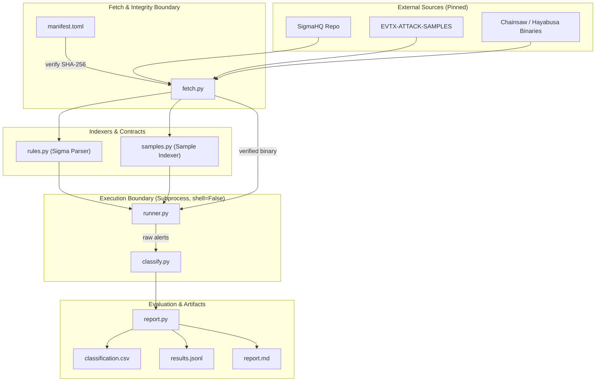

# Architecture Specification

## 1. System Overview
RuleProof is structured into modular Python packages orchestrated via a Typer CLI. It isolates untrusted log data and third-party binaries while maintaining end-to-end determinism.

## 2. Component Breakdown
- **`cli.py`**: Command-line entrypoint exposing subcommands (`fetch`, `inspect`, `run`, `report`) with single-line descriptions and actionable error handling.
- **`config.py`**: Central configuration resolving paths, environment settings, and loading [manifest.toml](../manifest.toml).
- **`models.py`**: Pydantic v2 data models defining schemas for rules, samples, engine detections, and classifications.
- **`fetch.py`**: Pinned downloader verifying SHA-256 digests and handling Darwin quarantine attributes securely.
- **`rules.py`**: Sigma rule loader extracting YAML metadata (ID, title, logsource, ATT&CK tags, status) without evaluating arbitrary YAML tags.
- **`samples.py`**: Attack sample indexer pairing EVTX files with author-declared MITRE technique IDs and provenance.
- **`runner.py` & `engines/`**: Subprocess-based engine executor (`chainsaw.py`, and later `hayabusa.py`) isolating engine invocations.
- **`classify.py`**: Detection classification engine implementing exact and hierarchical ATT&CK matching rules.
- **`report.py`**: Deterministic writer producing standardized markdown and structured tabular datasets.

## 3. Trust Boundaries
- **Untrusted Zone**: EVTX log samples, community Sigma YAML files, and external engine binaries.
- **Execution Boundary**: Subprocess calls are executed strictly with explicit argument lists, no shell expansion, and no write permissions to source data.
- **Trusted Zone**: RuleProof parsing logic, classification rules, and metrics calculations.
